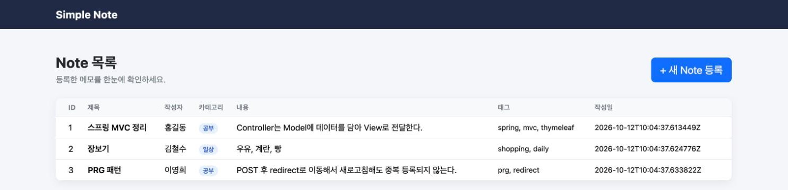
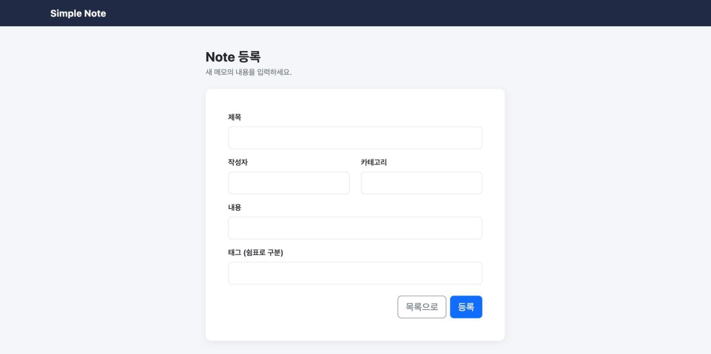
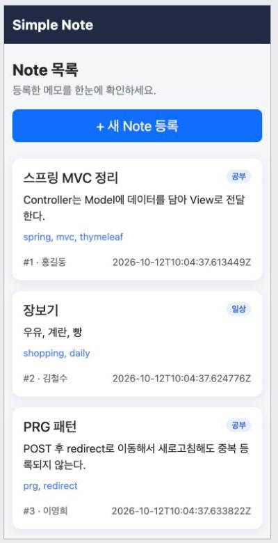

# simple_note_html

## ① 프로젝트 소개

4주차 Memory 기반 Note CRUD 프로젝트에 Thymeleaf Web UI와 HTML Form을 추가한 메모 관리 웹 애플리케이션입니다. DB 없이 메모리에 저장하며, Bootstrap 5로 반응형 화면을 구성했습니다.

**프로젝트 주제**: 메모(Note) 관리

**Render 배포 URL**: https://two026webservice-assign06.onrender.com

**프로젝트 구조**

```
src/main
├── java/com/seohamin/simple_note_html
│   ├── SimpleNoteHtmlApplication.java
│   ├── controller/NoteWebController.java
│   ├── service/NoteService.java
│   ├── repository/NoteRepository.java        (인터페이스)
│   ├── repository/MemoryNoteRepository.java  (LinkedHashMap 저장소)
│   ├── domain/Note.java
│   └── dto/NoteRequestDto.java, NoteResponseDto.java
└── resources
    ├── templates/notes/list.html, form.html
    └── static/css/style.css
```

**실행 방법**

```bash
./gradlew bootRun
# http://localhost:8080/notes
```

**주요 화면**

| 목록 화면 (`GET /notes`) | 등록 화면 (`GET /notes/new`) |
|---|---|
|  |  |

모바일에서는 목록이 표 대신 카드로 바뀝니다.



**Web Endpoint**

| HTTP Method | URL | 기능 |
|---|---|---|
| GET | `/notes` | 전체 목록 |
| GET | `/notes/new` | 등록 Form |
| POST | `/notes` | 데이터 등록 |

## ② 이번 과제 키워드

- `@Controller`
- Thymeleaf
- Model
- `@ModelAttribute`
- HTML Form
- `redirect:`
- PRG Pattern
- Bootstrap
- Layered Architecture

## ③ 핵심 내용 정리

**Q1. `@Controller`와 `@RestController`는 무엇이 다른가요?**

`@RestController`는 데이터(JSON)를 반환하고, `@Controller`는 View 이름을 반환합니다. `NoteWebController`가 `"notes/list"`를 반환하면 Thymeleaf가 `templates/notes/list.html`로 HTML을 만듭니다. Service와 Repository는 4주차 구조를 그대로 두고 Controller와 View만 추가했습니다.

**Q2. Controller의 데이터는 어떻게 HTML로 전달되나요?**

`model.addAttribute("notes", noteService.getAllNotes())`로 Model에 저장하면 HTML에서 `${notes}`로 꺼내 쓸 수 있습니다. Controller와 HTML의 이름(`notes`)이 같아야 합니다.

**Q3. Thymeleaf는 Collection을 어떻게 출력하나요?**

`th:each="note : ${notes}"`로 목록을 하나씩 꺼내고, `th:text="${note.title}"`로 값을 출력합니다. 링크와 Form 주소는 `th:href`, `th:action`에 `@{...}`로 작성합니다.

**Q4. Form 데이터는 어떻게 Controller로 전달되나요?**

Form의 `input` `name`과 `NoteRequestDto`의 필드명(`title`, `author`, `category`, `content`, `tags`)이 같으면 Spring이 DTO를 만들어 값을 넣어 줍니다. JSON은 `@RequestBody`, Form 데이터는 `@ModelAttribute`로 받습니다.

**Q5. 등록 후 왜 `redirect:`를 사용하나요?**

POST 처리 뒤 View를 바로 반환하면 새로고침할 때 같은 POST가 다시 전송되어 중복 등록될 수 있습니다. `redirect:/notes`로 응답하면 브라우저가 새로 GET 요청을 보내므로 새로고침해도 POST가 반복되지 않습니다. 이 구조를 PRG(Post → Redirect → Get) Pattern이라고 합니다.

## ④ Weekly Report

**Key Learning**

1. `@Controller`는 View 이름을 반환하고, Thymeleaf가 Model의 데이터로 HTML을 만든다는 것을 알게 되었습니다.
2. Form의 `name`과 DTO 필드명이 같으면 `@ModelAttribute`로 자동 연결된다는 것을 확인했습니다.
3. 등록 후 `redirect:`로 GET을 다시 요청하면(PRG) 새로고침해도 중복 등록되지 않는다는 것을 배웠습니다.

**Web UI Flow**

```
Browser (GET /notes)
  → NoteWebController.list()
  → NoteService.getAllNotes()
  → NoteRepository (MemoryNoteRepository)
  → Memory (LinkedHashMap)
  → List<NoteResponseDto> → Model("notes")
  → Thymeleaf (notes/list.html)
  → HTML
```

**Form Flow**

```
HTML Form (POST /notes)
  → NoteWebController.create(@ModelAttribute NoteRequestDto)
  → NoteService.createNote()
  → NoteRepository (MemoryNoteRepository)
  → Memory (LinkedHashMap)
  → redirect:/notes
  → GET /notes → 목록 화면
```

**Problem & Solution**

AI가 만든 HTML에 강의 자료에 없는 문법이 섞여 있었습니다. 목록이 비었을 때 문구를 보여 주려고 `th:if="${#lists.isEmpty(notes)}"`를 썼고, Form에는 `required`, `<label>`, `<textarea>`를 넣었습니다. 강의 자료의 Thymeleaf는 `th:text`, `th:each`, `th:href`, `th:action`이고 Form은 `<input name="...">`이라서, 자료와 대조해 `th:if`, `required`, `<textarea>`를 제거하고 `<input type="text">`로 바꿨습니다.

**Code Review: `NoteWebController.create()`**

```java
@PostMapping("")
public String create(@ModelAttribute final NoteRequestDto noteRequestDto) {
    noteService.createNote(noteRequestDto);

    return "redirect:/notes";
}
```

Form 데이터를 `@ModelAttribute`로 DTO에 받고, 등록한 뒤 View를 반환하지 않고 `redirect:/notes`로 보냅니다. 이 한 줄 덕분에 새로고침해도 POST가 다시 실행되지 않고(PRG), Form에서 저장까지의 흐름이 이 메서드 하나에 모여 있어서 가장 중요하다고 생각했습니다.

**AI Usage**

- Claude Code를 사용해 Bootstrap 반응형 화면, Dockerfile, README 초안을 도움받았습니다.
- 직접 확인한 부분: URL(`/notes`, `/notes/new`), HTTP Method(GET/POST), Form `action`(`th:action="@{/notes}"`), input `name`과 DTO 필드의 일치, Model 변수명(`notes`)과 `th:each`의 일치를 확인했습니다.
- 직접 수정한 부분: 이해하지 못하는 코드를 걷어냈습니다.
- 브라우저에서 `/notes`, `/notes/new`, 등록 후 redirect를 직접 확인했습니다.

**Reflection**

Form에 빈 값을 넣고 등록하면 Service가 400을 던져서 Spring 기본 에러 페이지가 나옵니다. REST API에서는 400 응답이 자연스러웠는데, Web UI에서는 입력 화면에서 오류 안내를 보고 다시 입력하게 하는 편이 맞을 것 같습니다. Form 화면으로 돌아가 오류 메시지를 보여 주는 방법이 궁금합니다.

**건의사항**

없습니다.
